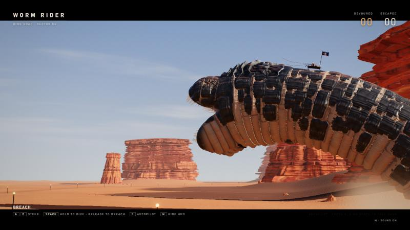
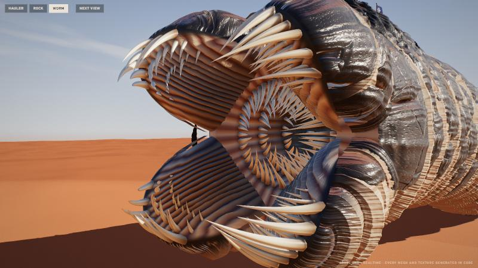
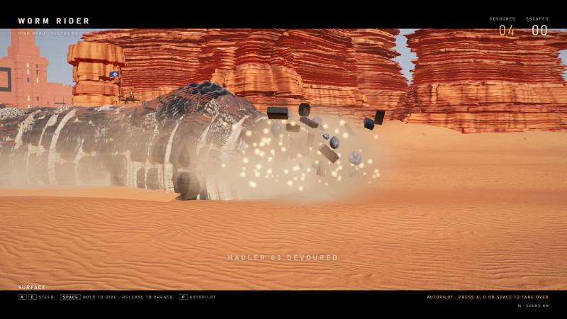
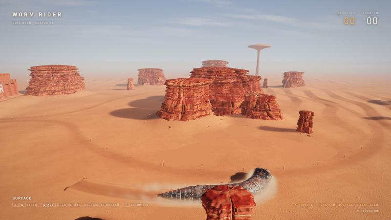
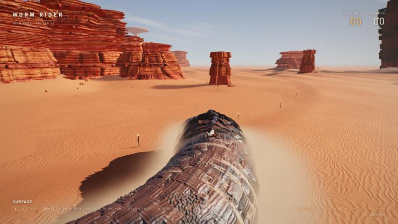

# Worm Rider

A one-scene playable prototype: ride a giant sandworm around a ring road and eat the hauler convoys before they get back through the gate.



Every mesh and texture is generated in code at load: there are no 3D model files and no texture files. The worm, sand and drone sounds are synthesised in the browser. The only code dependency is three.js (r165, loaded from jsDelivr), with no build step.

| | |
| --- | --- |
|  |  |
|  |  |

## Files that are not included

The original build uses four files that cannot be redistributed, so they are not in this repository. The game runs without them.

- Three licensed sound recordings layered over the synthesised sound. Without them hauler explosions fall back to a synthesised impact and there is no ambience bed. To use your own, put 48 kHz WAV files in `assets/`: `explosion-a.wav` and `explosion-b.wav` (layered when a hauler is destroyed) and `ambience-desert.wav` (looping wind).
- A horizon image wrapped around the sky. Without it the sky is fully procedural. To use your own, put a wide desert horizon picture at `assets/backdrop.webp` (horizon line about a third of the way up).

## Run

```
node serve.mjs
```

Then open http://127.0.0.1:5350/

- `index.html` is the game. Add `?start=1` to skip the title card, `?auto=0` to start in manual control.
- `lab.html?a=truck|rock|worm&cam=N` is the asset lab: each hero asset alone under the scene light.
- `look-frame-01.html` is the first mood frame, kept for reference.

## Controls

| Key | Action |
| --- | --- |
| A / D or arrows | steer |
| Space (hold) | dive; release to breach |
| Mouse drag | swing the camera around the worm |
| Mouse wheel | move the camera in or out |
| Double-click or V | reset the camera |
| P | autopilot on / off (it also takes over after 12 s without input) |
| C | force the cinematic camera |
| H | hide the HUD (clean frame for capture) |
| M | sound on / off |

## How it is built

| File | What it does |
| --- | --- |
| `src/tex.js` | GPU baker for every tiling texture (sand, metal, sandstone, hide, flesh) |
| `src/mats.js` | shared surface layer: triplanar micro detail and sand dust on standard PBR materials |
| `src/env.js` | sky with the horizon backdrop, sun, image-based light, post chain (depth of field, bloom, lens flare, grade) |
| `src/world.js` | terrain, ring road, stratified buttes, gate megastructure, wrecked hull, tower, baked far shadows |
| `src/rock.js` | sandstone formations; one global bed sequence shared by all of them |
| `src/truck.js` | the hauler; geometry is built once and reused by the whole convoy |
| `src/wormskin.js` | the worm's hide as one height function, baked to normal and mask maps and read back for displacement |
| `src/worm.js` | worm body, crest, four-lobed maw, teeth; built straight, bent along a spine |
| `src/wormrig.js` | GPU spine bending and the head / trail simulation (dive, breach, landing) |
| `src/rider.js` | howdah, rider, cloak, banner |
| `src/convoy.js` | hauler behaviour on the road |
| `src/fx.js` | dust and spark particles, wreckage, the ploughed furrow |
| `src/audio.js` | synthesised rumble, sand hiss, drone and impacts, plus the recorded explosion and ambience layers |
| `src/game.js` | loop, input, autopilot, cameras, HUD |

## Known limits

- The worm passes through sand without deforming the terrain mesh; the furrow ribbon and dust stand in for it.
- Far shadows on the terrain are baked for a fixed sun; live shadows cover about 150 m around the action.
- No ambient-occlusion pass in the game (the lab has one).
- Internal resolution is capped at about 1080p worth of pixels and drops further on its own if frames run long (`?px=3686400` raises the cap, `?dyn=0` turns the automatic drop off).

## Capturing video

`src/capture.js` records frame-locked footage: it steps the game at exactly 60 fps, composites the HUD, posts JPEG frames to the local server and renders the soundtrack offline. From the browser console:

```js
import('./src/capture.js').then(m => m.run(60))
```

Frames, `audio.wav` and an event log land in `capture/`; cut them together with ffmpeg.

## How it was made

Built in one working session with Claude (Fable 5.2) in Claude Code: asset lab first (hauler, rock, worm alone under the scene light), then the world, then the game loop, cameras, effects and sound.

## License

MIT. See [LICENSE](LICENSE).
