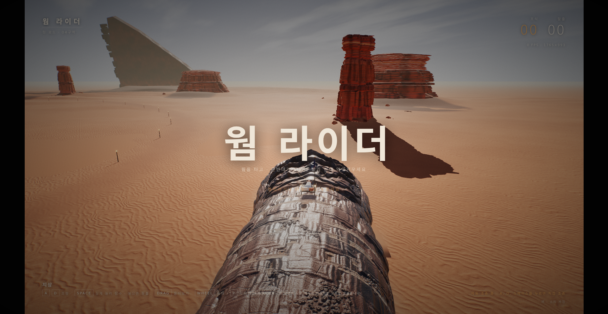
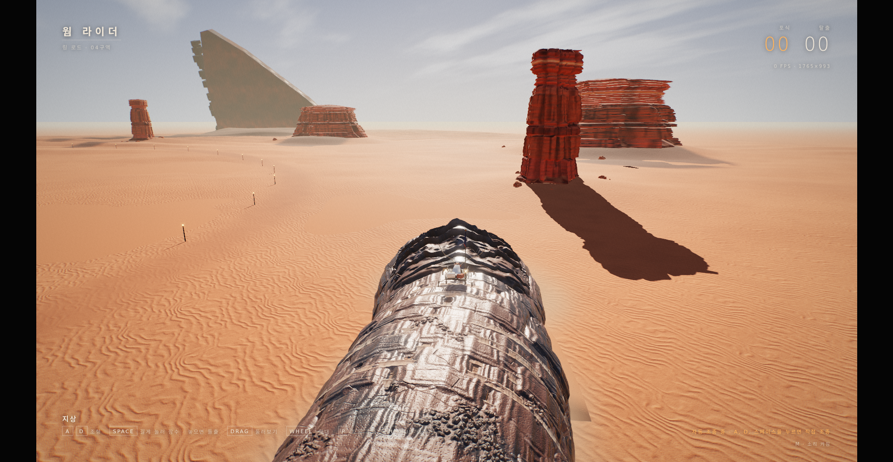

# 웜 라이더 (Worm Rider) — 한국어판

거대한 샌드웜을 타고 링 로드를 누비며, 운반대가 관문으로 돌아가기 전에 먹어치우는 한 장면짜리 플레이 가능 프로토타입입니다.

이 저장소는 [amirmushichge/worm-rider](https://github.com/amirmushichge/worm-rider)의 **비공식 한국어판**입니다. 게임 플레이, 확률, 수치는 원작과 동일하며 화면에 보이는 문구만 한국어로 옮겼습니다.

**지금 플레이:** https://sigco3111.github.io/worm-rider-ko/





## 주요 특징

- 모든 메시와 텍스처를 실행 시 코드로 생성합니다. 3D 모델 파일도, 텍스처 파일도 없습니다.
- 웜, 모래, 드론 소리도 브라우저에서 합성합니다.
- 유일한 코드 의존성은 three.js(r165, jsDelivr에서 로드)이며 빌드 단계가 없습니다.
- 원작에 포함되지 않았던 파일(녹음된 폭발음·앰비언스, 지평선 배경 이미지)은 이 저장소에도 없으며, 없어도 정상 동작합니다. 원작 README의 안내에 따라 `assets/`에 직접 넣어 쓸 수 있습니다.

## 실행

배포 페이지에서 바로 플레이하거나, 로컬에서 실행할 수 있습니다.

```
node serve.mjs
```

그 다음 http://127.0.0.1:5350/ 을 엽니다.

- `index.html`이 게임입니다. `?start=1`을 붙이면 타이틀 카드를 건너뛰고, `?auto=0`이면 수동 조종으로 시작합니다.
- `lab.html?a=truck|rock|worm&cam=N`은 에셋 실험실입니다. 장면 조명 아래 각 자산을 따로 볼 수 있습니다.
- `look-frame-01.html`은 첫 무드 프레임으로, 참고용 원문 그대로 두었습니다.

## 조작

| 키 | 동작 |
| --- | --- |
| A / D 또는 방향키 | 조향 |
| 스페이스 (길게) | 잠수; 놓으면 돌출 |
| 마우스 드래그 | 웜 주위로 카메라 돌리기 |
| 마우스 휠 | 카메라 확대/축소 |
| 더블 클릭 또는 V | 카메라 초기화 |
| P | 자동 조종 켜기/끄기 (12초 동안 입력이 없어도 켜집니다) |
| C | 시네마틱 카메라 강제 전환 |
| H | HUD 숨기기 (캡처용 깨끗한 화면) |
| M | 소리 켜기/끄기 |

## 기술 노트

| 파일 | 역할 |
| --- | --- |
| `src/tex.js` | 모든 타일링 텍스처(모래, 금속, 사암, 가죽, 살점)를 굽는 GPU 베이커 |
| `src/mats.js` | 공통 표면 레이어: 트라이플래너 마이크로 디테일과 모래 먼지 |
| `src/env.js` | 지평선 배경이 있는 하늘, 태양, IBL, 후처리 체인(피사계 심도, 블룸, 렌즈 플레어, 그레이드) |
| `src/world.js` | 지형, 링 로드, 층리 뷰트, 관문 거대구조물, 난파선, 탑, 베이크된 원거리 그림자 |
| `src/truck.js` | 운반차; 지오메트리를 한 번 만들어 행렬 전체가 재사용 |
| `src/wormskin.js` | 하나의 높이 함수로 만든 웜의 가죽; 노멀·마스크 맵으로 베이크 |
| `src/worm.js` | 웜의 몸체, 볏, 네 갈래 아가리, 이빨 |
| `src/wormrig.js` | GPU 척추 굽힘과 머리/꼬리 시뮬레이션(잠수, 돌출, 착지) |
| `src/rider.js` | 하우다, 기수, 망토, 깃발 |
| `src/convoy.js` | 도로 위 운반대 행동 |
| `src/fx.js` | 먼지와 불꽃 파티클, 잔해, 갈아엎은 흔적 |
| `src/audio.js` | 합성된 저음 울림, 모래 소리, 드론, 충격음 |
| `src/game.js` | 루프, 입력, 자동 조종, 카메라, HUD |

## 알려진 한계

- 웜이 지형 메시 변형 없이 모래를 통과하며, 흔적 리본과 먼지가 이를 대신합니다.
- 지형의 원거리 그림자는 고정된 태양 기준으로 베이크되어 있고, 실시간 그림자는 액션 주변 약 150m만 덮습니다.
- 게임에는 앰비언트 오클루전 패스가 없습니다(실험실에는 있습니다).
- 내부 해상도는 약 1080p 분량으로 제한되며 프레임이 길어지면 스스로 더 낮춥니다(`?px=3686400`으로 상한을 올리거나 `?dyn=0`으로 자동 하향을 끌 수 있습니다).

## 한국어판 변경 사항

- 타이틀, HUD(포식/탈출, 상태, 조작 안내), 로딩 문구, 알림 토스트, 음소거 표시, 에셋 실험실을 한국어로 옮겼습니다.
- 한글 표시를 위해 Noto Sans KR 서브셋(실사용 글리프만 추린 15.7KB woff2)을 추가했습니다. 라틴 서체는 원작과 동일하게 우선 적용되어 원래 분위기를 유지합니다.
- 게임 로직, 수치, 조작감은 원작과 동일합니다.

## 라이선스 및 크레딧

- 원작: [Worm Rider](https://github.com/amirmushichge/worm-rider) by Amir Mušić, MIT License ([LICENSE](LICENSE))
- three.js (MIT), jsDelivr CDN에서 로드
- 한글 글꼴: [Noto Sans KR](https://fonts.google.com/noto/specimen/Noto+Sans+KR), SIL Open Font License 1.1 ([assets/fonts/OFL.txt](assets/fonts/OFL.txt))
- 원작의 영어 README 원문은 [README.original.md](README.original.md)에 보존했습니다.
